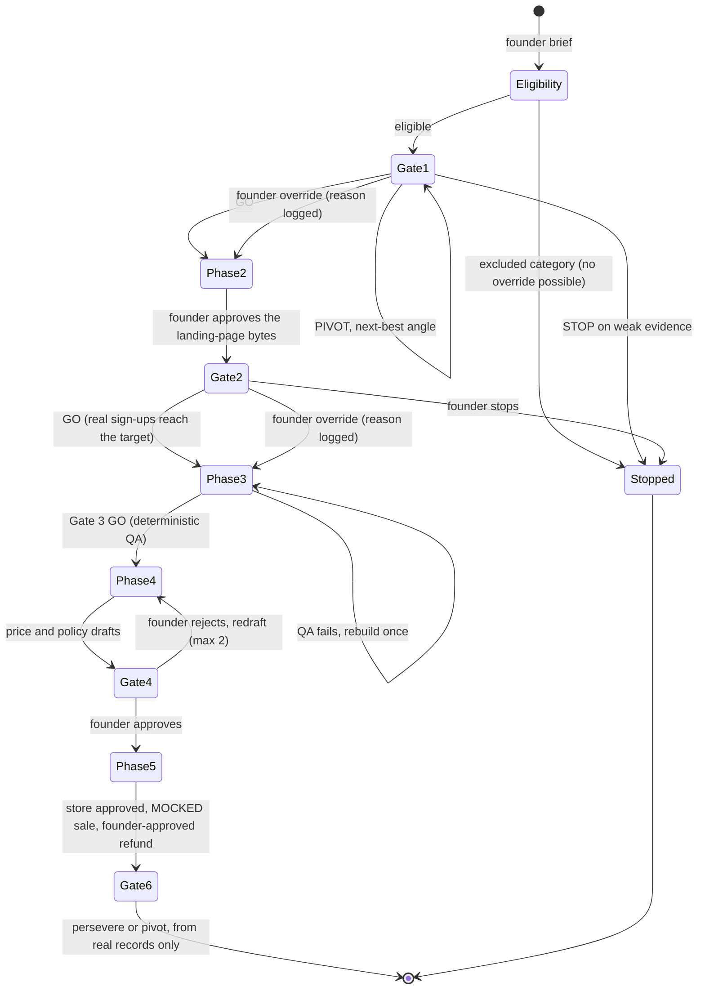
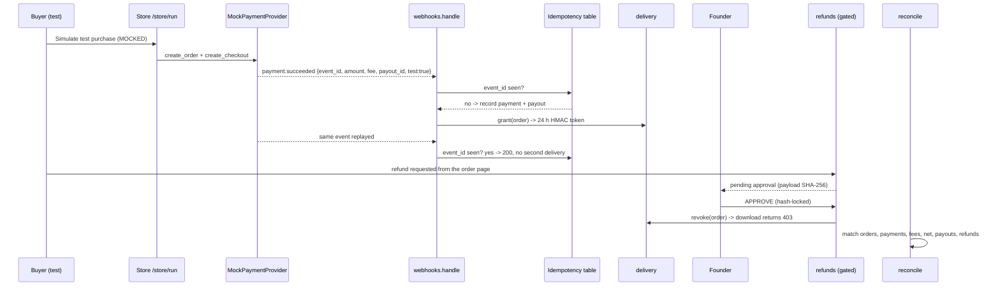

# ProveIt architecture

## Overview

ProveIt is an open-source team of eleven agents that takes a founder's brief through six phases, with a gate after every step. Plain Python code calls every tool, cuts every quote, decides every gate and executes every approved action; the open-weight model only extracts sentence IDs, summarises and argues. By default the model runs locally: `docker compose up` starts Ollama and downloads `qwen3:4b-instruct-2507-q4_K_M` into a volume, so no key or account is needed; `LLM_PROVIDER=nvidia` switches the same OpenAI-compatible client (`proveit/llm.py`) to NVIDIA Nemotron 3 Ultra on NVIDIA's free hosted tier, which the committed demo runs used. Before any source is called, the gate thresholds and the brief are hashed (SHA-256) and logged as the first decision-log entry, so moving the goalposts later is visible. J.A.R.V.I.S., the spoken assistant, and the console sit on top: they narrate and explain real run data in plain words and never invent it.

```mermaid
flowchart LR
  B[Founder brief<br/>6 fields] --> E{Eligibility<br/>guard rule set B}
  E -- excluded --> X1[STOP]
  E --> P0[Pre-register thresholds<br/>SHA-256 logged first]
  P0 --> P1[Phase 1 Discover<br/>Scout, Researcher, Verifier, Debate]
  P1 --> G1{Gate 1 evidence<br/>gates.py rules 0-7}
  G1 -- stop --> X2[STOP + sources]
  G1 -- repeat --> R1[Mom Test interviews /<br/>broader queries]
  G1 -- pivot --> P1
  G1 -- go --> P2[Phase 2 Validate<br/>Lean Canvas, landing page]
  P2 --> A1{{Founder approval<br/>publish_landing_page}}
  A1 --> G2{Gate 2 demand<br/>real sign-ups}
  G2 -- repeat: 0 real sign-ups --> O[Founder override<br/>logged, preview only]
  O --> P3[Phase 3 Build<br/>spec, modules, docs]
  G2 -- go --> P3
  P3 --> G3{Gate 3 QA tests}
  G3 -- go --> P4[Phase 4 Commercial<br/>pricing, policy drafts]
  P4 --> G4{{Gate 4 founder<br/>approve / reject}}
  G4 --> P5[Phase 5 Launch<br/>store, post draft]
  P5 --> A2{{Founder approval<br/>open_store}}
  A2 --> S2C[Sale to cash<br/>MOCKED]
  S2C --> P6[Phase 6 Operate and learn<br/>support, metrics]
  P6 --> G6{Gate 6 persevere or pivot<br/>real records only}
```



| Gate | Checks | Outcomes |
|---|---|---|
| Eligibility | Excluded categories (rules + model) | stop / continue |
| Gate 1 evidence | weighted sourced pain, distinct sources, recency, payment signals, competitor band, founder fit, source coverage | go / repeat / pivot / stop |
| Gate 2 demand | real waitlist sign-ups vs pre-registered target (test sign-ups excluded) | go / repeat / pivot / stop |
| Gate 3 tests | deterministic QA of the product files | go / repeat |
| Gate 4 commercial | founder approves price and policy drafts | go / stop |
| Gate 6 operate | real orders, refund rate, real sign-ups vs pre-registered bars | go / repeat / pivot / stop |
| Every publish, refund | founder approval bound to the payload SHA-256 | executed / blocked |

## Phases

### Phase 1: Discover

- **Agents:** Intake (`agents/intake.py`), Guard (`proveit/guard.py`), Scout (`agents/scout.py`), Researcher (`agents/researcher.py`), Verifier (`proveit/verifier.py`), Advocate and Skeptic (`agents/debate.py`), Gatekeeper (`proveit/gates.py`).
- **Tools:** Hacker News Algolia API, Stack Exchange API, GitHub repository search, SearXNG (self-hosted metasearch, result pages fetched and split), Wikipedia summary (context only). Reddit is STUBBED.
- **Method (Core step 1.1 Find opportunities):**
  1. Step 0 intake: the 6-field brief (only the idea is required) is checked by guard rule set B (excluded categories, allow-list, ask-the-founder tier) and the generation-intent part of rule set A; labelled briefs are parsed by code, free text by one model call. Missing fields become `ASSUMPTION: unspecified`.
  2. Thresholds are pre-registered: `sha256(canonical_json({gates.yaml, brief}))` is the first log entry.
  3. Scout returns 3 variants (segment, job to be done, 3 pain-phrased queries, a competitor query, a Stack Exchange site, a language). Founder fit (0-5) is computed in code from the brief.
  3a. **Compare against alternatives (code only, `agents/scorer.py`):** each variant first gets the same excluded-category check as the brief (an excluded or possibly excluded angle is shown but never researched or pivoted to). The Scorer then runs each eligible variant's pain queries against Hacker News comments from the evidence window and counts on-topic, first-person complaints; signal = complaints + 0.25 x on-topic + 2 x fit share. The strongest is researched first; PIVOT goes to the next-best untried angle, and the verdict on the angle left behind is kept as `phase1_gate_variant-<n>`. The counts rank angles only and are never gate evidence.
  4. Sources run in parallel with per-run call caps and 8 s timeouts. Records are normalised, split into numbered sentences by `pysbd`, ranked by keyword overlap and trimmed to 12 hits x 6 prose sentences (code, tables and diagrams skipped).
  5. The Researcher reads 7 threads per call and returns only `{hit_id, sentence_ids, kind, claim_text}`. Code joins the sentences into the quote, so the quote is verbatim by construction. **Two readers:** any shown sentence that passes code's published test (first person, on topic, a pain or payment cue, not a question, link or pitch) but that the model skipped is added by code as a claim and verified like every other claim, so an under-selecting model cannot hide evidence.
  6. The Verifier re-fetches each public URL (5 s, parallel) and checks `partial_ratio(quote, page) >= 95`: `verified_live` 1.0, `archived_match` 0.5 (0 for web pages), `unverified` 0 (ASSUMPTION). A claim keeps weight only if code finds >= 2 shared stemmed keywords with the variant and the pain or payment cue matching its kind.
  7. Market definition (step 1.3) is built by code from verified competitor and price claims; a market size appears only if a source states one, otherwise ASSUMPTION.
  8. Mom Test kit (step 1.4): 8 past-behaviour questions and a notes template; on REPEAT for insufficient evidence it adds a 5-interview plan described by profiles, never named people.
  9. Advocate and Skeptic each write 2-3 Statements citing claim IDs; then code decides Gate 1.
- **Output:** `phase1_step1_opportunities`, `phase1_step2_claims` (full ledger), `phase1_step3_market`, `phase1_step4_interview-kit`, `phase1_gate_decision` (outcome, rule fired, metrics vs thresholds, hash, both arguments, claim table, sources).

### Phase 2: Validate

- **Agents:** Strategist (`agents/strategist.py`), Guard, Gatekeeper.
- **Tools:** Jinja2 template `templates/landing.html.j2` (no slots for reviews, ratings, counters or timers), FastAPI `/p/<run>`.
- **Method (Core step 2.1 Design the business):** a Lean Canvas where every cell is a list of Statements; `render.py` keeps a citation only when the cited quote shares >= 2 keywords and contains every number in the statement, otherwise the statement is printed as `ASSUMPTION:`. Riskiest assumption and the experiment are named. Landing copy fields pass rule set C and the model check, are regenerated once if blocked, and unsourced market statements are labelled. The founder approves the exact HTML bytes before `/p/<run>` serves them. Public hosting is STUBBED, so every sign-up is stored with `test=true` and excluded.
  1. The Strategist writes the Lean Canvas from the verified claims of the researched angle. Legal-agreement wording (for example "deposit agreements") is rewritten by code into operational terms, and the rewrite is logged (`rewrite_legal_terms`).
  2. Landing copy (headline, subheadline, benefits, FAQ) passes the outward guard. A blocked draft is regenerated once with the violation named; if it is still blocked, code drops the blocked benefits or FAQ items and flags anything left for the founder.
  3. Code puts each FAQ question in `q` and its answer in `a`, and labels every unsourced factual statement ASSUMPTION.
  4. The rendered page is stored under its SHA-256 and served at `/p/<run>` only after the founder approves those exact bytes (`publish_landing_page`). A rejected page is redrafted at most twice.
  5. **Gate 2** counts real sign-ups only, against the pre-registered target (100 in 14 days, ASSUMPTION); test sign-ups never count.
- **Output:** `phase2_step1_lean-canvas`, `phase2_step2_landing-page`, `phase2_gate_decision`.

### Phase 3: Build

- **Agents:** Builder (`agents/builder.py`), QA (`agents/qa.py`).
- **Tools:** CSV writer, guard rule set C, factual-statement detector.
- **Method (Core step 3.1 Build the product):** product spec (title, audience, modules, what it is not), one module in live mode (three in full mode) as a verb-first checklist plus a CSV template, and buyer docs assembled by code. QA runs deterministic checks (modules present, verb-first items, no banned claims, CSVs parse, internal links resolve, word counts); a failure triggers one rebuild with the failures named. After a Gate 2 override every file carries "PREVIEW after a founder override: demand not yet proven".
  1. The Builder writes the spec, then each module as a checklist and a CSV template; the buyer guide is assembled by code from the modules.
  2. **Gate 3** runs six deterministic QA checks: modules present, checklist items start with a verb, no banned claims, no evaluation words, CSV templates parse, internal links resolve.
  3. A failed build is rebuilt once with the failing checks named; if it still fails, the run waits for the founder.
  4. Unsourced factual statements in the spec and modules are labelled ASSUMPTION, and every statement is recorded in `provenance.json`.
- **Output:** `phase3_step1_product-spec`, `phase3_step2_module-1`, `phase3_step2_template-1`, `phase3_step3_user-docs`, `phase3_gate_test-report`.

### Phase 4: Commercial setup

- **Agents:** Pricer (`agents/pricer.py`), Policy drafter (`agents/policy_drafter.py`).
- **Method (Core step 4.1 Set the price and policies):** code computes Good/Better/Best tiers from the quartiles of verified price points; with fewer than 2 verified points every price is ASSUMPTION. The model only writes a cited rationale. No revenue projections of any kind. Terms, privacy (it lists exactly what is stored: an email and a timestamp) and refund drafts are stamped "DRAFT - not legal advice". No payments of any kind are set up here.
- **Method (Core step 4.2 Policy drafts):** terms, privacy and refund drafts, each stamped "DRAFT - not legal advice; review with a qualified professional." They pass the guard's policy rules (money words such as refund and payment are allowed there). Invented contact emails are replaced by a placeholder for the founder's own. Code writes what is stored (an email and a timestamp, and MOCKED order records; no passwords or card numbers) and the refund window (14 days, ASSUMPTION), with every refund approved by the founder. A Gate 4 rejection redrafts Phase 4 at most twice, then the run stops.
- **Gate 4:** the founder approves or rejects price and policies (UI button or CLI).
- **Output:** `phase4_step1_pricing`, `phase4_step2_policies`, `phase4_gate_decision`.

### Phase 5: Launch (sell, deliver, get paid)

Phase 5 is named "Launch" in the problem statement and "Sell / deliver / get paid" in the submission conventions; both describe the same phase.

- **Agents:** Launcher (`agents/launcher.py`), executor (`proveit/approval.py`), payments, webhooks, delivery, refunds, reconcile (`proveit/commerce/`; the root files of the same names are aliases).
- **Method (Core step 5.1 Open the store; deliver automatically):** a template-locked store page with a literal "No reviews yet" and a "Simulate test purchase (MOCKED)" button (no card form exists anywhere), plus one launch post headed "DRAFT - NOT POSTED. For the founder to post under their own name." The founder approves `open_store` for the exact HTML bytes. The mocked sale to cash then runs: purchase, webhook, delivery, replay, gated refund, revocation and reconciliation.
- **Method (Core step 5.2 Payment -> delivery -> refund, MOCKED):** after the founder approves the store bytes (`open_store`), a test purchase creates an order, the mock provider sends a signed `payment.succeeded` webhook, and the handler delivers a 24-hour signed download token once; replaying the same event delivers nothing. A refund without founder approval raises `ApprovalRequired`; once approved, it revokes the download (403), and reconciliation matches orders, payments, fees, net and payouts. Details in [Sale to cash](#sale-to-cash).
- **Launch post:** code states what the product contains from the built modules (never the model), and the post stays a draft: posting adapters are STUBBED and gated.
- **Output:** `phase5_step1_store-page`, `phase5_step1_launch-post-draft`, `phase5_step3_reconciliation`, `payment_test_log`.

### Phase 6: Operate and learn

- **Agents:** Analyst and Support (`agents/analyst.py`), code only, reading real records (test orders and test sign-ups never count). STUBBED in the demo only because there is no live launch, so every real count is 0.
- **Method:** (1) support answers to the questions buyers ask most, built only from the run's approved files (user docs, price, policies, delivery); drafts that are never sent without the founder. (2) A metrics plan: each metric, where it is read from, and its pre-registered bar (`gate6_operate` in `config/gates.yaml`, hashed with the brief). (3) Gate 6 by rule, first match wins: >= 5 real orders with refund rate <= 10% -> GO (persevere); >= 5 orders but refunds above the bar -> PIVOT back to Phase 3; 30 days after launch with real sign-ups under 30% of the waitlist target -> STOP; otherwise REPEAT (not enough data).
- **Gate 6 (code, real records only):** persevere (GO) at >= 5 real orders in the first 30 days with a refund rate <= 10%; PIVOT when buyers came but refunds exceed that; STOP when, after 30 days, real sign-ups are under 30% of the waitlist target; otherwise REPEAT (not enough data). The thresholds are team defaults (ASSUMPTION) in `config/gates.yaml`.
- **Output:** `phase6_step1_memo`, `phase6_step2_support-answers`, `phase6_step3_metrics`, `phase6_gate_decision`.

### Interface: the console and J.A.R.V.I.S.

- **Workspace (the "tactical writing" mode):** a welcome screen with three steps for first-time founders; per idea, a six-step progress bar, the verdict card (one big word, a plain-language reason, counts of complaints / people who'd pay / existing tools, bars against the pre-registered bar), decision buttons labelled by their effect and offered only when the server says they are valid (`allowed_decisions`), a next-step card (for REPEAT: the interview kit), and tabs for Evidence (verbatim quotes with their source links and why each counted or didn't), For and against (only cited arguments count), Approvals (the exact bytes to approve, hash-locked), Files (rendered Markdown) and What's real (Working / MOCKED / STUBBED).
- **Voice (the "holographic voice HUD" mode) and Both (dual-sync):** a canvas visual driven by WebAudio `AnalyserNode` (Piper audio or the microphone), hold-to-talk, saying the assistant's name, and the conversation.
- **J.A.R.V.I.S.:** the assistant (you call it by saying "Jarvis"). Typed or spoken text goes through guard rule set A and the model check first; then a fixed router sends commands (approve, change the bar, rerun, evaluate a new idea, edit copy) to code, quote questions to code (verbatim quotes, never paraphrased), and everything else to the model with the run's facts only. Answers stream sentence by sentence; each sentence passes the guard; a dropped sentence is announced, never silently skipped. "Approve" only opens the approval card: a message is never an approval.
- **Quality floor:** WCAG 2.2 AA contrast tokens, a skip link, ARIA tabs with arrow keys, live regions for verdicts and answers, keyboard shortcuts (`Ctrl K`, `N`, `1-3`, `?`), visible focus, reduced-motion support, designed 404/403/409/500 pages, a connection-lost banner with back-off, security headers (CSP with `frame-ancestors`, `nosniff`, a microphone-only Permissions-Policy), per-client rate limits on model-spending routes, self-hosted fonts and a print stylesheet for the evidence report.

## Gates

Every step ends with a check: schema validation of model output (Pydantic, one retry), the guard, a founder approval, or a deterministic test.

| Step | Check |
|---|---|
| Intake | Guard B + A (rules), model check, schema |
| Scout, Researcher, Debate, Strategist, Builder, Pricer, Policy, Launcher | JSON schema + Pydantic validation, one retry, then REPEAT `model_failure` |
| Claims | Code-built quote, live re-check, relevance + cue check |
| Statements | `render.py` citation support or `ASSUMPTION:` |
| Outward copy | Guard C + model check, regenerate once; if still blocked, code drops the blocked sentences or FAQ items, then flags anything left for the founder. What the product contains is written by code from the built modules |
| Publish, open store, refund | `@gated(action)` with payload SHA-256 |
| Product | QA tests (Gate 3) |

**Gate 1 thresholds** (`config/gates.yaml`, team defaults shown as ASSUMPTION): weighted sourced pain >= 6, distinct sources >= 2, >= 50% of counted pain within 24 months, >= 1 payment signal, 1-15 distinct verified competitors, founder fit >= 3 of 5, coverage >= 0.5, max 2 repeats.

**Rule precedence** (first match wins; each rule has its own test in `tests/test_gates.py`):

| # | Condition | Outcome |
|---|---|---|
| 0 | Researcher output invalid after a retry, or >= 3 code-qualified sentences left unselected | REPEAT (`model_failure` / `model_suspect`): a broken model must never look like a weak idea |
| 1 | Excluded category | STOP |
| 2 | coverage < 0.5 | REPEAT, `insufficient_evidence`, next step `mom_test_interviews`: never STOP on silence |
| 3 | sourced pain < 3 with coverage OK | STOP: the topic is discussed but nobody complains or pays |
| 4 | All checks pass | GO |
| 5 | Pain OK, competitors out of band or founder fit low | PIVOT to the next variant |
| 6 | Every failed check >= 60% of target and repeats < max | REPEAT with broader queries |
| 7 | Otherwise | STOP |

**When the system recommends STOP on weak evidence:** rule 3 fires when public sources do discuss the topic (coverage is fine) but fewer than 3 weighted, on-topic pain signals survive the code checks. The committed weak run shows this. A thin market that our sources cannot see is a REPEAT with an interview plan, not a STOP.

**Pre-registration is tamper-evident, not tamper-proof:** the hash is logged before the first source call; `gates.evaluate_gate1()` recomputes it and a mismatch sets `goalpost_moved: true`, logged and shown in red.

**Gate 2:** while public hosting is STUBBED, every sign-up is `test=true` and excluded, so 0 real sign-ups gives REPEAT `insufficient_evidence`. Continuing needs `founder_override_against_evidence` (reason required, guard-checked, logged with `approved_by: "founder"`), and Phases 3-5 are labelled a preview.

### Founder control: each rule, the code that enforces it, and the test that proves it

| Rule | Enforced in code by | Proven by |
|---|---|---|
| Nothing is published, sent, spent or signed without the founder | `@gated(action)` in `proveit/approval.py`, bound to the SHA-256 of the exact bytes the founder saw; spend, sign and account creation always raise | `tests/test_approval.py` (`test_blocked_without_approval`, `test_one_changed_byte_voids_the_approval`, `test_spend_sign_create_account_always_raise`) |
| Never hold, move or refund money on its own | Payments are MOCKED; `refunds.refund` is `@gated("refund")` and revokes the download | `tests/test_sale_to_cash.py` (`test_refund_without_approval_raises`, `test_refund_with_approval_revokes_download`) |
| Never store passwords or card details | No card field exists in any template, table or API; guard rule `credentials` refuses such requests | `tests/test_sale_to_cash.py::test_no_card_fields_anywhere`, `tests/test_guard.py::test_rules_only_must_refuse` |
| Never promise income or guarantee success | Guard rule set A `income_promise` (requests) and rule set C `income` (outward copy) | `tests/test_guard.py::test_rules_only_must_refuse`, `tests/test_guard_scope.py::test_store_price_is_not_an_income_claim` |
| No fake reviews, testimonials, sign-ups or countdown timers | Rules `fake_social_proof`, `fake_signups`, `urgency`; templates have no slots for reviews, ratings, counters or timers; sign-ups on the local page are `test=true` and never count | `tests/test_guard.py::test_rules_only_must_refuse`, `tests/test_guard_scope.py::test_landing_copy_with_social_proof_is_blocked` |
| Never pose as the founder, a customer or a brand | Rules `impersonation`, `customer_voice`, `invented_experience`; posting adapters are STUBBED and gated | `tests/test_guard.py::test_outward_copy_never_invents_the_founders_reason_or_experience` |
| A message is never an approval | Rule `bypass` ("ignore the rules", "the founder already approved", "skip approval") | `tests/test_guard.py::test_heldout_founder_said_yes_is_refused_by_the_rules_layer` |
| Market claims are sourced or labelled ASSUMPTION | Quotes cut by code and re-checked live (`proveit/verifier.py`); `proveit/render.py` keeps a citation only when the quote supports it, otherwise labels ASSUMPTION | `tests/test_pipeline_smoke.py` (`test_statement_artifacts_sourced`, `test_no_unsourced_market_claims_in_prose`) |
| Recommend STOP when the evidence is weak; never STOP on silence | Gate 1 rules 2, 3 and 7 in `proveit/gates.py` | `tests/test_gates.py`, `tests/test_pipeline_smoke.py::test_weak_brief_stops` |
| Excluded products (physical, financial, health, legal advice) never proceed | Guard rule set B at intake, the same check on every Scout angle; the founder cannot override it | `tests/test_pipeline_smoke.py::test_excluded_category_stops_at_eligibility`, `tests/test_guard.py::test_scout_angles_get_the_excluded_category_check_and_are_never_pivoted_to` |

**The gates as a state machine** (each arrow is a code decision or a logged founder action; nothing moves past a gate on the model's word):



## Sale to cash

Everything here is MOCKED: an in-process provider, no real or sandbox payments, no card fields, every order `test=true`.



- **Payment triggers delivery:** `webhooks.handle()` records the payment and payout, then `delivery.grant()` issues an `itsdangerous` token valid for 24 hours for `GET /download/{token}`.
- **Idempotency prevents double delivery:** the `webhook_events` table is keyed by `event_id`, so a replayed event returns 200 with `duplicate: true` and no second delivery; and an order can be paid only once (its status must be `created`), so a second, different payment event for the same order, or a late event after a refund, never re-grants access.
- **Only real (mock) events count:** every mock event is HMAC-SHA256 signed with `SECRET_KEY`; an unsigned or altered event is refused with 401 and writes nothing. Malformed bodies get 400, never a server error.
- **A refund revokes access:** `refunds.refund(order_id, approval_id)` is `@gated("refund")`, so it raises `ApprovalRequired` without the founder's approval of the exact payload; once approved it revokes the token and the download returns 403.
- **Reconciliation:** `reconcile.run()` matches each order to its payment, fee, net and payout and to any refund, and flags mismatches (`phase5_step3_reconciliation.csv`). The fee model is an "illustrative ASSUMPTION: 2.9% + $0.30, typical card-processor pricing".

## Data flow

```text
source API / SearXNG page --> Hit{id, url, text}
  code: normalize() (strip HTML, unescape, straight quotes, collapse whitespace) -> pysbd -> S1..Sn
        (<= 6 sentences per hit, <= 12 hits)
LLM (Researcher) --> [{hit_id:"H3", sentence_ids:[2,3], kind:"pain", claim_text:"..."}]   IDs only
code --> quote = " ".join(sentences[2..3])            verbatim by construction
Verifier --> GET public URL -> same normalize() -> partial_ratio(quote, page) >= 95 ?
    verified_live   found on the live page                     weight 1.0
    archived_match  not confirmed live; verbatim API record    weight 0.5 (HN/SE/GitHub), 0 (web)
    unverified      quote could not be built (ASSUMPTION)      weight 0
Relevance --> counts only if >= 2 shared stemmed keywords with segment + job
              AND the pain / payment / price cue (config/cues.yaml, English + Arabic) agrees with the kind
Metrics --> gates.py (pure) --> GateDecision --> decision_log + phase1_gate_decision
Statements --> render.py --> [C1][C3] footnotes + Sources, or "ASSUMPTION: ..."
```

Storage: SQLite in WAL mode (`busy_timeout=5000`) on a named Docker volume holds runs, the action log, approvals, payload blobs keyed by SHA-256, sign-ups and the mocked orders. Every run writes only to `runs/<run_id>/`; `python -m proveit promote` is the only writer of `outputs/` and `runs/promoted/decision_log.json`, and `make promote` copies that log to the repository root. The decision log has one row per agent action with `action`, `sources`, `model`, `cost` and `approved_by`, plus `timestamp`, `agent` and `run_id`.

Privacy: with the default local model, briefs, evidence and questions never leave the computer; search queries derived from the brief go to Hacker News, Stack Exchange, GitHub and SearXNG's engines; the waitlist stores only an email and a timestamp.

Code layout: `proveit/orchestrator.py` is the pipeline's public entry point; `proveit/pipeline/` holds the run model (`run.py`), the run loop (`engine.py`), Phase 1 research (`research.py`), the outward-copy guard (`copy_guard.py`) and one module per phase in `stages/`; `proveit/reports/` writes every output file, one module per phase; `proveit/decisions.py` applies founder decisions and approvals; `proveit/gates.py` decides gates (pure functions); `proveit/verifier.py` builds and checks quotes; `proveit/guard.py` holds the rule sets; `proveit/llm.py` is the model client; `proveit/metrics.py` keeps the alerting counters; `agents/` holds one module per agent role; `app/api.py` assembles the web service from the routers in `app/routes/` (the JSON API is versioned under `/api/v1/`, with Prometheus counters at `/api/v1/metrics`) and `app/security.py` is its HTTP security layer; the sale-to-cash code (`payments`, `webhooks`, `delivery`, `refunds`, `reconcile`) lives in `proveit/commerce/`, and the root files `orchestrator.py`, `gates.py`, `approval.py`, `payments.py`, `webhooks.py`, `delivery.py`, `refunds.py` and `reconcile.py` are aliases of those modules.

## Built vs. stubbed

| Part | Status |
|---|---|
| Intake, eligibility, guard (rules + model check) | Working |
| Scout, Researcher, Verifier, ledger, relevance check | Working |
| Market definition, Mom Test kit | Working (interview-notes analyser STUBBED) |
| Debate + Gate 1 (rules 0-7, pre-registration) | Working |
| Lean Canvas, landing page + waitlist on localhost | Working |
| Public hosting of the landing page | STUBBED (sign-ups are test=true) |
| Gate 2 demand | Working |
| Builder, QA, Gate 3 | Working |
| Pricing, policy drafts, Gate 4 | Working |
| Store page, launch post draft | Working |
| Posting / email adapters | STUBBED (gated, raise NotEnabled) |
| Payment, delivery, refund, reconciliation | MOCKED |
| Phase 6 analyst memo | STUBBED (code memo from real metrics) |
| Reddit source | STUBBED |
| Console, J.A.R.V.I.S. assistant, voice | Working |
| Local Piper voice / faster-whisper fallback | Working when the optional voice packages are installed; otherwise the browser voice is used |


### How the stubbed parts would work

Each stub sits behind the same interface and the same approval gate as the working code, so replacing it changes no gate rule:

- **Public hosting (STUBBED):** the approved landing-page blob (the exact SHA-256 bytes the founder approved) is deployed to a static host by the existing `@gated("publish_landing_page")` action. Sign-ups from the public page are stored with `test=0`, and only those count at Gate 2 against the pre-registered waitlist target (100, ASSUMPTION).
- **Posting and email adapters (STUBBED):** one adapter per channel behind `@gated("publish_post")` or `@gated("send_email")`. The founder approves the exact text, and the adapter posts through an account the founder connects; ProveIt never creates accounts, never stores passwords and never posts as the founder without approval.
- **Payments (MOCKED):** a payment provider in sandbox/test mode replaces `MockPaymentProvider` behind the same `create_order` / `create_checkout` interface. Its webhooks keep the same signature check, the same idempotency by event and by order, and refunds stay `@gated("refund")`; reconciliation reads the provider's fees and payouts instead of the mock's.
- **Phase 6 analyst (STUBBED):** after a real launch, the memo and Gate 6 read real sign-ups, orders and refunds (test records excluded, as now), with `days_since_launch` counted from the first real order. The decision rule stays code; the model only drafts the memo from those numbers.
- **Reddit source (STUBBED):** a `sources.base.Source` subclass using the official API once access is granted, with the same per-run caps, timeout and circuit breaker as the other sources.
- **Interview-notes analyser (STUBBED):** the founder pastes notes from the five Mom Test interviews; code counts strong signals (past behaviour, money already spent, a current workaround) against weak ones (compliments, hypotheticals) with cue lists like `config/cues.yaml`, and the result is a separate, labelled evidence source for a Gate 1 re-check.

## Roadmap

- **December 2026:** interview-notes import (counts strong and weak signals from five Mom Test conversations); Product Hunt and IndieHackers sources; SearXNG on by default.
- **January 2027:** the calibration set ([evals/gate_backtest.md](evals/gate_backtest.md)) grown to 50 ideas with 90-day outcomes.
- **February 2027:** a micro-tool product format; opt-in publishing adapters, still approval-gated and hash-bound.
- **v1.0:** a community-hosted instance with no paywall on core features. Details: [docs/roadmap.md](docs/roadmap.md).
